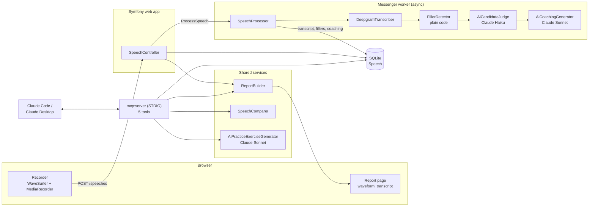

# Ah Counter

Ah Counter helps public speakers, especially Toastmasters members, notice and cut their filler words. You record a short English speech in the browser, and it gives you a **Report**: every "um", "uh", "like" and "you know" with its timestamp, Fillers per minute, a breakdown by Filler Type, a waveform you can click through, and short **Coaching**. Claude Code and Claude Desktop can read the same Reports, compare two speeches and write you a practice drill through an MCP server.

It is named after the Toastmasters meeting role that counts a speaker's "ums" and "ahs".

Built for the Symfony AI & MCP Hackathon (November 2026) with Symfony 8.1 and Symfony AI 1.0.0-BETA1.

> **Local-only demo app.** There are no accounts and no access control: anyone who can reach the server can see every Speech. Run it on your own machine only.
>
> **English only.** Filler detection and the transcription settings are English-specific.
>
> **Privacy.** To analyse a Speech, its audio is sent to [Deepgram](https://deepgram.com) for transcription, and its transcript text is sent to [Anthropic](https://www.anthropic.com) for judging and Coaching. The demo data needs neither.

## What it does

1. **Record** a 10-second to 5-minute speech in the browser, with a live waveform and timer. Listen back, give it a title, then press *Analyse*.
2. **Transcribe** it with Deepgram Nova-2, which keeps filler sounds and times every word.
3. **Find the Fillers.** Filler Sounds ("um", "uh", "hmm", …) are matched in code. Filler Phrases ("like", "so", "you know", "I mean", "right", "well", …) are only *Candidates*: "I like pizza" isn't a filler. Claude Haiku judges each one in the context of its sentence.
4. **Coach.** Claude Sonnet writes a short summary, the patterns it sees and up to three tips, based only on the Fillers found.
5. **Report.** Stat cards, the waveform with a marker per Filler, a breakdown by Filler Type, the Coaching, and the transcript with Fillers highlighted. Click any word or Filler to hear it.
6. **Ask Claude.** Five MCP tools let Claude Code or Claude Desktop list your Speeches, read a Report, list the Fillers, compare two Speeches and generate a Practice Exercise.

## Requirements

- PHP 8.4 or newer with the `pdo_sqlite`, `ctype`, `iconv` and `fileinfo` extensions (`php -m` lists them)
- [Composer](https://getcomposer.org)
- The [Symfony CLI](https://symfony.com/download) (recommended; there is a fallback without it)
- Chrome or Safari for recording
- To analyse your own speeches: a [Deepgram](https://console.deepgram.com) API key and an [Anthropic](https://console.anthropic.com) API key. To only look around, use the demo data and skip the keys.

No Node.js, no Docker, no database server: assets use AssetMapper, styles use the Tailwind standalone binary, and data lives in a SQLite file.

## Setup

```bash
git clone <this repository> um-tracker
cd um-tracker
composer install
bin/console doctrine:migrations:migrate -n
bin/console tailwind:build
```

`tailwind:build` downloads the Tailwind binary the first time, so it needs internet access once.

### API keys (to analyse your own speeches)

Create `.env.local` in the project folder (git ignores it) with your keys:

```dotenv
DEEPGRAM_API_KEY=your-deepgram-key
ANTHROPIC_API_KEY=your-anthropic-key
```

The models are set in `.env` and can be overridden in `.env.local` too: `AI_JUDGE_MODEL=claude-haiku-5-5`, `AI_COACH_MODEL=claude-sonnet-5-5`, `DEEPGRAM_MODEL=nova-2`.

### Demo data (no keys needed)

```bash
bin/console app:load-demo
```

This loads two Speeches that were already processed for real: a first attempt and an "improved" second one with fewer Fillers. It prints their URLs. You get full Reports and every MCP tool except `generate_practice_exercise` (including `compare_speeches`) without any API key. Running it again changes nothing.

## Run it

```bash
symfony serve -d
```

Open the URL it prints (usually 127.0.0.1:8000; https if you ran `symfony server:ca:install`). `.symfony.local.yaml` also starts the background worker that processes Speeches (exactly one) and a Tailwind watcher. Stop everything with `symfony server:stop`.

The Symfony CLI loads the project's `php.ini`, which raises PHP's upload limit from 2 MB to 25 MB, enough for a 5-minute Recording.

### Without the Symfony CLI

Use two terminals:

```bash
# Terminal 1: the web server, with the upload limits from php.ini
php -d upload_max_filesize=25M -d post_max_size=30M -S 127.0.0.1:8000 -t public

# Terminal 2: the worker that transcribes and analyses Speeches
bin/console messenger:consume async
```

Then open <http://127.0.0.1:8000>.

## Use it from Claude (MCP)

`bin/console mcp:server` runs an MCP server over STDIO with five tools:

| Tool | What it does | Needs an API key |
|---|---|---|
| `list_speeches` | Your recent Speeches with status, Filler count and Fillers per minute | no |
| `get_speech_report` | One Speech's Report: statistics, breakdown by Filler Type, Coaching, and the Transcript with Fillers in `[brackets]` | no |
| `list_fillers` | Every Filler with its time and context; optionally the Candidates the AI judge rejected, with its reason | no |
| `compare_speeches` | A later Speech against a baseline: change in Fillers per minute, overall and per Filler Type (negative = better) | no |
| `generate_practice_exercise` | A short speaking drill aimed at a Speech's most frequent Filler Type, or one you name | `ANTHROPIC_API_KEY` |

### Claude Code

The repository ships a `.mcp.json`, so Claude Code finds the server by itself:

1. Start `claude` in the project folder.
2. Approve the `ah-counter` server when Claude Code asks (or run `/mcp` and enable it).
3. Ask, for example: *"Compare my last two speeches and give me an exercise for my worst filler."*

### Claude Desktop

Claude Desktop starts servers from its own folder with a minimal `PATH`, so give it absolute paths. Open **Settings → Developer → Edit Config** (`~/Library/Application Support/Claude/claude_desktop_config.json` on macOS) and add:

```json
{
    "mcpServers": {
        "ah-counter": {
            "command": "/opt/homebrew/bin/php",
            "args": ["/absolute/path/to/um-tracker/bin/console", "mcp:server"]
        }
    }
}
```

- Replace `/absolute/path/to/um-tracker` with where you cloned the project (`pwd` in the project folder prints it).
- Replace `/opt/homebrew/bin/php` with the output of `which php` (PHP 8.4 or newer).
- If the file already has an `mcpServers` object, add the `ah-counter` entry to it.

Restart Claude Desktop. The tools appear under the tools icon in the chat box.

## Architecture



- **One pipeline, resumable.** `SpeechProcessor` runs the first step whose output is still empty (transcript, then Fillers, then Coaching) and saves each output as soon as it is ready. A Retry after a failure picks up where it stopped. Short-lived failures (rate limits, timeouts) are retried by Messenger; permanent ones (bad key, no speech heard) fail the Speech with a readable message.
- **Statistics are computed, not stored.** `ReportBuilder` turns the saved Fillers into a Report each time it's needed. The web pages and the MCP tools share that one code path, so they always agree.
- **MCP tools are thin.** Each tool in `src/Mcp/` loads the Speech, calls a service and returns JSON. Business logic stays in the services.

## How Symfony AI is used

| Package | Used for |
|---|---|
| `symfony/ai-platform` + `symfony/ai-deepgram-platform` | Transcription with Deepgram Nova-2 (`filler_words=true`). The bridge's text result drops timestamps, so `DeepgramTranscriber` reads per-word timings from the raw response after the converter has raised any HTTP error ([ADR 0001](docs/adr/0001-transcription-provider.md)). |
| `symfony/ai-bundle` + `symfony/ai-anthropic-platform` | Three structured-output calls, each answering with a readonly PHP DTO through `response_format`: **Claude Haiku** judges Filler Phrase Candidates in context (`CandidateVerdicts`); **Claude Sonnet** writes the Coaching (`Coaching`) and Practice Exercises (`PracticeExercise`). `App\Ai\ClaudeClient` sets the output token budget (the default 1000 truncated answers once the model's thinking counted) and sorts failures into permanent and retryable. |
| `symfony/mcp-bundle` (`mcp/sdk` 0.9) | The STDIO MCP server: `#[McpTool]` and `#[Schema]` on service methods, `ToolCallException` for readable tool errors. |
| `symfony/ai-mate` + Symfony and Monolog extensions | Developer tooling for coding agents: profiler, logs, container and environment diagnostics (`symfony php vendor/bin/mate tools:list`). Plus a project skill at `.claude/skills/ah-counter/SKILL.md`. |

Tests never call a real API: the AI adapters run against Symfony AI's `MockPlatformFactory`, the Deepgram transcriber against mock HTTP responses. Model names are configuration (`AI_JUDGE_MODEL`, `AI_COACH_MODEL`, `DEEPGRAM_MODEL`), not code.

## Accuracy

Measured with `bin/console app:accuracy-check` on three of the owner's own recordings (Chrome, webm/opus, 51–56 s each): clip-1 full of fillers, clip-2 natural, clip-3 with few fillers. Nobody hand-counted the clips, so the tables compare providers and verdicts with each other, not with a known truth.

**Filler Sounds kept by each transcription provider** (ticket 04, [ADR 0001](docs/adr/0001-transcription-provider.md)):

| Provider | clip-1 | clip-2 | clip-3 |
|---|---|---|---|
| Deepgram Nova-3 | 0 | 0 | 0 |
| **Deepgram Nova-2** (used) | 4 (um 1, uh 3) | 0 | 2 (uh 2) |
| OpenAI Whisper, with a filler-rich prompt | 7 (um 3, ah 3, hmm 1) | 0 | 3 (er 3) |

Nova-3 dropped every filler even with `filler_words=true`, so the app uses Nova-2. Every filler Nova-2 found has a Whisper match within 2 s; Whisper hears a few more. So the Report tends to under-count rather than over-count, and Deepgram writes "ah" and "er" as "uh".

**Filler Phrases judged by Claude Haiku** (ticket 14, `--judge`, Deepgram Nova-2 transcripts, run 2026-11-17):

| Clip | Candidates | Judged Fillers | Examples |
|---|---|---|---|
| clip-1 | 10 | 5 (you know ×2, like ×2, so ×1) | Rejected "I *like* to build websites" and "*right* now"; accepted "*you know*, this is a test" and "the best, *like*… how do I say it?" |
| clip-2 | 2 | 1 (well) | Accepted the opening "*Well*, I started…"; rejected "*So* I only ended up…" as a real "therefore" |
| clip-3 | 2 | 0 | Rejected both "*so* you don't have to…" (purpose clauses) |

The judge is told to prefer *not filler* when unsure, to avoid over-counting. In clip-1 it also kept both words of "so so fast" as intensifiers, which a human might count as one filler. Rejected Candidates stay visible, faded with the judge's reason as a tooltip, so you can disagree with it. Run `bin/console app:accuracy-check --judge -v` on your own clips in `tests/accuracy/` (see its [README](tests/accuracy/README.md)).

## Tests

```bash
php bin/phpunit
```

The suite runs offline with no API keys. It covers the Filler detector, Report maths, comparisons, the AI adapters (against a mock platform), the resumable pipeline, every controller, the demo commands and the MCP tools. It also has an end-to-end test that starts `bin/console mcp:server` as a real subprocess and checks that every line it writes to STDOUT is valid JSON-RPC.

## Project docs

- [`docs/SPEC.md`](docs/SPEC.md): the full design
- [`GLOSSARY.md`](GLOSSARY.md): the domain vocabulary (Speech, Recording, Filler, Candidate, Report, Coaching, …)
- [`docs/adr/`](docs/adr/): decisions with lasting consequences
- [`docs/tickets/`](docs/tickets/): the work plan, in order
- [`docs/demo-script.md`](docs/demo-script.md): the 90-second video script

## License

[MIT](LICENSE)
